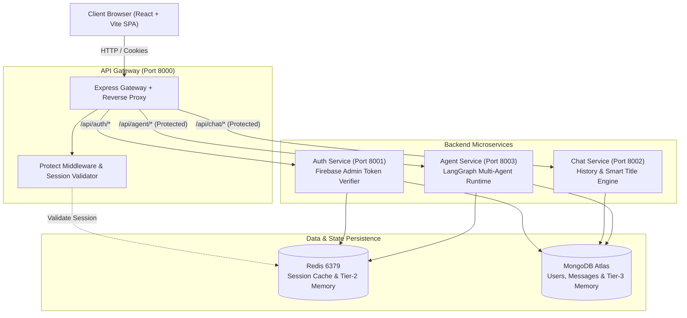
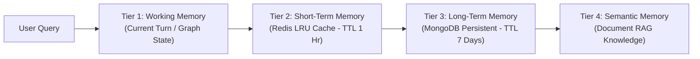

# 🌐 AgentMesh: Autonomous Distributed Multi-Agent AI Network

<div align="center">


**An enterprise-grade, distributed multi-agent intelligence network powered by LangGraph, autonomous A2A (Agent-to-Agent) collaboration, 4-tier cognitive memory, self-healing code reflection, and live interactive sandboxes.**

[Features](#-key-features) • [Architecture](#-system-architecture) • [Agents](#-neural-agent-registry) • [Memory Engine](#-4-tier-cognitive-memory-engine) • [Docker & Deployment](#-docker--container-deployment) • [Quickstart](#-local-quickstart-guide)

</div>

---

## 🌟 Key Features

- 🧠 **LangGraph Dynamic Agent Mesh**: State-graph routing with autonomous intent detection and fallback failover cascades.
- 🤝 **Agent-to-Agent (A2A) Bus**: Decentralized peer-to-peer delegation between agents with cycle loop guards (`depth <= 2`).
- 🛡️ **Andrew Ng Reflection & Self-Healing Loop**: Deterministic Node.js V8 AST compiler validation and automated syntax recovery before sandbox rendering.
- ⚡ **Non-Blocking Background Execution**: Start complex generations, switch conversations or create new chats instantly with live Redux status badges.
- 📦 **Live Interactive Artifact Sandbox**: Multi-file code workspace (HTML, CSS, JS) with real-time execution in an isolated iframe.
- 🗄️ **4-Tier Cognitive Memory Engine**: Hierarchical memory pipeline combining Working, Short-Term (Redis), Long-Term (MongoDB), and Semantic RAG.
- 🔍 **Autonomous Deep Research Planner**: Parallel sub-query decomposition, multi-vector Tavily search dispatches, and recursive document synthesis.
- 📄 **Direct In-Memory PDF RAG**: Streamed PDF document parsing, buffer-level vector chunking, and semantic citation extraction without local disk bloat.
- 🐳 **Full Containerization**: Production-ready Dockerfiles for Gateway, Auth, Chat, and Agent microservices.

---

## 🏗️ System Architecture

AgentMesh utilizes a **distributed microservices topology** managed through an API Gateway with reverse-proxying, token authentication, and Redis session validation.



---

## 🤖 Neural Agent Registry

Every agent in the mesh is specialized for a distinct cognitive domain:

| Agent Identifier | Primary Capability | Key Integrations & Architecture |
|---|---|---|
| **`codingAgent`** | Multi-file web application synthesis & modification | Full visual HTML DOM layouts, complete JS state machines, Node V8 AST static validator & Reflection loop. |
| **`deepResearchAgent`** | Multi-stage autonomous deep research & synthesis | Sub-query decomposition planner, parallel web dispatches, structured executive reports with citations. |
| **`webAgent`** | Real-time live web intelligence & fact retrieval | Tavily Live API, financial tickers, current news, inline image resolutions. |
| **`pdfRagAgent`** | Direct PDF document questioning & analysis | In-memory Buffer extraction via `pdfkit`/`pdf2json`, semantic chunking, and context citation retrieval. |
| **`pptAgent`** | Structured executive presentation generation | Slide deck schema generation with slide-by-slide markdown layouts. |
| **`pdfAgent`** | Formal document & report generator | Clean structured document markdown formatting with exportable structures. |
| **`imageAgent`** | Multimodal visual generation & prompt synthesis | AI image prompt crafting and dynamic visual asset resolution. |
| **`chatAgent`** | Conversational intelligence & memory contextualizer | 4-tier memory integration with contextual conversational synthesis. |
| **`routerAgent`** | Intent classification & DAG node dispatcher | Low-latency semantic classification (`openai/gpt-oss-20b`). |

---

## 🔄 Andrew Ng's Agentic Reflection Loop

To prevent broken code or runtime syntax errors, `codingAgent` uses a **Deterministic Compiler Critic Loop**:

```text
[User Prompt] ──► [LLM Generator] ──► [V8 AST & DOM Validator]
                                            │
                    ┌───────────────────────┴───────────────────────┐
                    ▼                                               ▼
         ❌ Syntax/DOM Errors Found                         ✅ 100% Valid
                    │                                               │
                    ▼                                               │
      [Reflection Prompt + Diagnostics]                             │
                    │                                               │
                    ▼                                               │
           [LLM Auto-Healing]                                       │
                    │                                               │
                    └───────────────────────┬───────────────────────┘
                                            │
                                            ▼
                          [Interactive Sandbox Artifact]
```

---

## 🧠 4-Tier Cognitive Memory Engine

AgentMesh uses a hierarchical memory system mirroring human cognitive architecture:



1. **Tier 1 (Working Memory)**: Active state graph variables within LangGraph.
2. **Tier 2 (Short-Term Memory)**: Ephemeral Redis cache storing recent conversational turns with rolling 1-hour expiration.
3. **Tier 3 (Long-Term Memory)**: Persistent MongoDB collection tracking cross-session preferences and past conversation digests (7-day TTL).
4. **Tier 4 (Semantic Memory)**: Dynamic vector chunking and document retrieval.

---

## 🌐 Network Topology & Port Mapping

```
AgentMesh Platform
├── Frontend SPA        ────────► http://localhost:5173 (Vite Dev Server)
├── API Gateway         ────────► http://localhost:8000 (Express Gateway Proxy)
├── Auth Microservice   ────────► http://localhost:8001 (Firebase Admin & Auth)
├── Chat Microservice   ────────► http://localhost:8002 (Conversations & History)
├── Agent Microservice  ────────► http://localhost:8003 (LangGraph Mesh Runtime)
└── Redis In-Memory DB  ────────► localhost:6379 (State & Session Store)
```

---

## 📁 Repository Structure

```
AgentMesh/
├── backend/
│   ├── gateway/                  # API Gateway (Port 8000)
│   │   ├── controllers/          # User & proxy controllers
│   │   ├── middleware/           # Redis session protection middleware
│   │   ├── utils/                # Proxy with headers decorator
│   │   ├── Dockerfile            # Gateway container config
│   │   └── index.js              # Gateway entrypoint
│   ├── services/
│   │   ├── auth/                 # Authentication Microservice (Port 8001)
│   │   │   ├── config/           # Firebase admin SDK initialization
│   │   │   ├── controllers/      # Login, session generation & logout
│   │   │   ├── model/            # User Mongoose model
│   │   │   ├── router/           # Auth routes
│   │   │   ├── Dockerfile        # Auth container config
│   │   │   └── index.js          # Auth service entrypoint
│   │   ├── chat/                 # Chat History Microservice (Port 8002)
│   │   │   ├── config/           # Database connection
│   │   │   ├── controller/       # Conversation CRUD & Smart Titles
│   │   │   ├── model/            # Conversation & Message schemas
│   │   │   ├── routes/           # Chat REST endpoints
│   │   │   ├── Dockerfile        # Chat container config
│   │   │   └── index.js          # Chat service entrypoint
│   │   └── agent/                # Agent Intelligence Microservice (Port 8003)
│   │       ├── a2a/              # Agent-to-Agent Event Bus & Registry
│   │       ├── agents/           # Specialized Agent implementations
│   │       ├── config/           # Resilient LLM Model Matrix & S3
│   │       ├── controllers/      # Agent dispatch controller
│   │       ├── graph/            # LangGraph workflow definitions & state
│   │       ├── routes/           # Agent execution routes
│   │       ├── utils/            # Tool resolvers & telemetry tracers
│   │       ├── Dockerfile        # Agent container config
│   │       └── index.js          # Agent service entrypoint
│   ├── shared/                   # Shared Redis connection singleton
│   └── docker-compose.yml        # Multi-container orchestration
├── frontend/                     # React 18 + Vite SPA (Port 5173)
│   ├── src/
│   │   ├── components/           # Sidebar, ChatArea, Live Artifact Sandbox
│   │   ├── config/               # Firebase Web Client SDK
│   │   ├── features/             # API services (messages, conversations)
│   │   ├── pages/                # Home Workspace & Login pages
│   │   └── redux/                # Global Redux Toolkit state stores
│   ├── package.json
│   └── vite.config.js
└── README.md
```

---

## 🚀 Local Quickstart Guide

### Prerequisites
- **Node.js**: v18.0.0 or higher
- **Redis**: Running locally on `localhost:6379` or via Docker
- **MongoDB**: Connection URI string (MongoDB Atlas or local)
- **API Keys**:
  - `GOOGLE_API_KEY` (Google AI Studio)
  - `GROQ_API_KEY` (Groq Console)
  - `TAVILY_API_KEY` (Tavily Search API)

---

### 1. Clone & Install Dependencies

```bash
# Clone the repository
git clone https://github.com/your-username/AgentMesh.git
cd AgentMesh

# Install Backend Root & Gateway dependencies
cd backend
npm install
cd gateway && npm install && cd ..

# Install Microservices dependencies
cd services/auth && npm install && cd ../..
cd services/chat && npm install && cd ../..
cd services/agent && npm install && cd ../..

# Install Frontend dependencies
cd ../frontend && npm install && cd ..
```

---

### 2. Configure Environment Variables

Create `.env` files in each service directory:

#### `backend/gateway/.env`
```env
PORT=8000
AUTH_PATH="http://localhost:8001"
CHAT_PATH="http://localhost:8002"
AGENT_PATH="http://localhost:8003"
FRONTEND_PATH="http://localhost:5173"
REDIS_URL="redis://localhost:6379"
```

#### `backend/services/auth/.env`
```env
PORT=8001
MONGODB_URI="your_mongodb_connection_string"
REDIS_URL="redis://localhost:6379"
```

#### `backend/services/chat/.env`
```env
PORT=8002
MONGODB_URI="your_mongodb_connection_string"
```

#### `backend/services/agent/.env`
```env
PORT=8003
CHAT_PATH="http://localhost:8002"
REDIS_URL="redis://localhost:6379"
GOOGLE_API_KEY="your_google_gemini_api_key"
GROQ_API_KEY="your_groq_api_key"
TAVILY_API_KEY="your_tavily_api_key"
```

#### `frontend/.env`
```env
VITE_SERVER_URL="http://localhost:8000"
VITE_FIREBASE_API_KEY="your_firebase_api_key"
```

---

### 3. Run Microservices Concurrently

Open separate terminal tabs:

```bash
# Tab 1: Start API Gateway
cd backend/gateway
npm run dev

# Tab 2: Start Auth Service
cd backend/services/auth
npm run dev

# Tab 3: Start Chat Service
cd backend/services/chat
npm run dev

# Tab 4: Start Agent Service
cd backend/services/agent
npm run dev

# Tab 5: Start Frontend
cd frontend
npm run dev
```

Visit **`http://localhost:5173`** to access the live workspace.

---

## 🐳 Docker & Container Deployment

Build all microservice images from the `backend/` directory:

```bash
cd backend

# 1. Build Gateway Container
docker build -f ./gateway/Dockerfile -t agentmesh-gateway .

# 2. Build Auth Service Container
docker build -f ./services/auth/Dockerfile -t agentmesh-auth .

# 3. Build Chat Service Container
docker build -f ./services/chat/Dockerfile -t agentmesh-chat .

# 4. Build Agent Runtime Container
docker build -f ./services/agent/Dockerfile -t agentmesh-agent .
```

---

## 🛡️ Reliability & Model Failover Matrix

To ensure zero downtime, AgentMesh implements a **Tiered Resilient Model Failover**:

```
[Request] ──► Primary Tier: Google Gemini 3.6 Flash
                   │ (Failover on Rate Limit / 5xx)
                   ▼
              Secondary Tier: Groq GPT-OSS 120B
                   │ (Failover on Error)
                   ▼
              Fallback Tier: Groq GPT-OSS 20B / DeepSeek
```

---

## 📜 License

This project is open-source under the [ISC License](LICENSE).

<div align="center">
  <b>Engineered with ❤️ by the AgentMesh Team</b>
</div>
